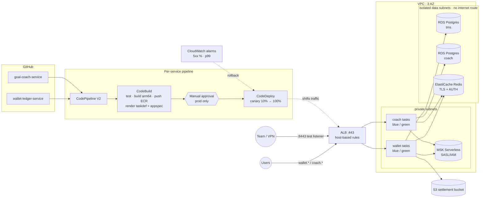

# terraform-ecs-fargate-bluegreen

[](https://github.com/viren97/terraform-ecs-fargate-bluegreen/actions/workflows/terraform.yml)

Production-style AWS platform, in Terraform, for running JVM microservices on **ECS Fargate** with
**Postgres, Redis, Kafka and S3**, and releasing them with **canary blue/green deployments that roll
back on their own**.

It hosts two real services:

| Service | What it is | Gets from the platform |
|---|---|---|
| [wallet-ledger-service](https://github.com/viren97/wallet-ledger-service) | Kotlin wallet + double-entry ledger | Own Postgres, Kafka topics `transaction.*`, Redis status cache, S3 bucket for settlement files, bank webhook HMAC secret |
| [goal-coach-service](https://github.com/viren97/goal-coach-service) | Java AI goal coach | Own Postgres, Kafka topics `coach.*`, Redis progress cache, Anthropic + FCM secrets |

Every module is also usable on its own (`source = "github.com/viren97/terraform-ecs-fargate-bluegreen//modules/<name>"`).

## Architecture



## How a release works

1. A push to `main` starts the service's pipeline.
2. CodeBuild runs the tests, builds an **arm64** image (Graviton, about 20% cheaper), and pushes it to ECR with the commit SHA as an **immutable** tag. It then renders `taskdef.json` and `appspec.yaml` from the live task definition, so the service repo only needs a `Dockerfile`.
3. In prod, a manual approval gate pauses the pipeline.
4. CodeDeploy starts **green** tasks. You can smoke-test them on the test listener (`:8443`, restricted to office/VPN CIDRs) before any user traffic arrives.
5. Traffic moves to green in a **10% canary for 5 minutes**, then 100%.
6. If the target group's **5xx rate** or **p99 latency** alarm fires at any point, CodeDeploy rolls back to blue on its own. Blue tasks stay up for 15 minutes after success, so a rollback is instant.

## Design decisions

| Decision | Why |
|---|---|
| **Database per service** | Keeps services independently deployable: one service can't reach into another's tables, and schema changes stay local. Redis and Kafka are shared but scoped (key prefixes, IAM per topic). |
| **MSK Serverless with IAM auth** | No brokers to size or patch. Each service's task role can only touch its own topics and consumer groups, so Kafka needs no passwords at all. |
| **No secret ever in Terraform state** | RDS manages and rotates its own master password. Third-party secrets are created as empty Secrets Manager entries and filled in out of band. ECS injects them at task start. |
| **Three-tier VPC** | Data stores sit in subnets with no route to the internet. Each security group only admits the security groups that need it, never CIDR ranges. |
| **Canary + alarm-based rollback** over rolling updates | A bad release reaches 10% of traffic for a few minutes, not everyone, and nobody has to be watching for a rollback to happen. |
| **One shared ALB, host-based rules** | One load balancer for every service. CodeDeploy swaps target groups per rule, so each service still deploys on its own. |
| **CMK per environment** | Logs, secrets, buckets, images and Redis are encrypted with one rotating key you control, with an audit trail. |
| **Partial S3 backend with native locking** | One root module for every environment; only `envs/<env>.tfvars` and `.s3.tfbackend` differ. Terraform ≥ 1.10 locks state in S3 itself, so no DynamoDB table is needed. |

## Layout

```
modules/
  network/            3-tier VPC, NAT per AZ (or single for dev), S3 endpoint
  alb/                shared HTTPS ALB, prod + test listeners
  ecs-cluster/        cluster, Fargate + Fargate Spot
  ecs-service/        service, blue/green TGs, IAM, autoscaling, alarms, CodeDeploy
  rds-postgres/       Postgres 16, Multi-AZ, managed master secret
  elasticache-redis/  Redis 7, TLS + AUTH, Multi-AZ failover
  msk-serverless/     Kafka with IAM auth, scoped ARN helpers
  s3-bucket/          secure-by-default bucket
  ecr/                immutable, scanned, lifecycle-managed repo
  pipeline/           CodePipeline V2 → CodeBuild → CodeDeploy
stack/                root module: composes the platform and the services map
envs/                 dev.tfvars, prod.tfvars, *.s3.tfbackend
.github/workflows/    fmt · validate · tflint · checkov · plan via OIDC
```

## Environments

| | dev | prod |
|---|---|---|
| AZs / NAT | 2 / single NAT | 3 / NAT per AZ |
| Postgres | `db.t4g.micro`, single-AZ | Multi-AZ, enhanced monitoring |
| Redis | 1 node | primary + replica, auto-failover |
| Tasks | min 1 | min 2, scale to 6 |
| Release | auto | manual approval + canary |
| Deletion protection | off | on |

## Usage

```bash
# one-time: state bucket, GitHub connection (approve it in the console), ACM wildcard cert
make init ENV=dev
make plan ENV=dev
make apply ENV=dev

# set third-party secrets once (names are in the `app_secret_ids` output)
aws secretsmanager put-secret-value --secret-id <arn> --secret-string '...'
```

Adding a service means adding one entry to `services` in the tfvars. You get its database, ECR repo, pipeline, alarms and deployment group.

### What the services need

The platform passes everything through the services' existing `docker` Spring profile (`DB_URL`, `REDIS_HOST`, `KAFKA_BOOTSTRAP_SERVERS`, …). Two things are needed on the service side for AWS:

- add `software.amazon.msk:aws-msk-iam-auth` to the classpath (MSK Serverless only accepts SASL/IAM);
- create topics with replication factor 3, or leave it unset (MSK Serverless does not allow 1).

## CI

Every PR runs `terraform fmt`, `validate` on each module and the stack, `tflint` with the AWS ruleset, and `checkov`. Once the `AWS_PLAN_ROLE_ARN` repository variable is set, it also runs `plan` for dev and prod through GitHub OIDC, with no long-lived AWS keys.

## Security scanning

Checkov runs in report-only mode. Remaining findings are deliberate trade-offs (for example, wildcard resources on `ecs:RegisterTaskDefinition` and `ecr:GetAuthorizationToken`, which don't support resource-level permissions).
