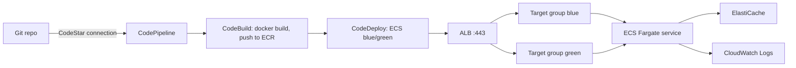

# ecs-fargate-with-ci-cd

Reusable Terraform modules for running a containerised service on **AWS ECS Fargate** behind an ALB, with a **CodePipeline → CodeBuild → CodeDeploy blue/green** delivery pipeline.

## Architecture



## Modules

| Module | What it creates |
|---|---|
| `vpc` | VPC with public and private subnets across `az_count` AZs, internet gateway, NAT gateways |
| `alb` | ALB with an HTTPS listener, blue and green target groups, security groups for the ALB, ECS tasks and the cache |
| `ecs` | ECS cluster (Container Insights on), Fargate task definition rendered from a JSON template, service wired to the ALB |
| `codebuild` | CodeBuild project that builds the image (privileged Docker), with S3 cache and CloudWatch/S3 build logs |
| `codedeploy` | CodeDeploy app and deployment group: ECS blue/green with traffic control and auto-rollback on failure |
| `codepipeline` | Source (CodeStar connection) → Build → Deploy (CodeDeployToECS) pipeline |
| `iam` | Task execution and task roles, plus roles for CodeBuild, CodeDeploy and CodePipeline |
| `cache` | ElastiCache cluster and subnet group |
| `logs` | CloudWatch log group and stream |
| `s3` | Private bucket for pipeline artifacts and build cache |

## Design notes

- **Blue/green over rolling updates:** CodeDeploy shifts the HTTPS listener between two target groups and rolls back automatically on `DEPLOYMENT_FAILURE`, so a bad release never takes all traffic.
- **Tasks in private subnets**, reached only through the ALB security group.
- **Modules, not a monolith:** each piece takes its dependencies as inputs (subnet IDs, role ARNs, target-group names), so they can be composed per environment.

## Usage

This repo contains modules only. Compose them from your own root module, for example:

```hcl
module "vpc" {
  source = "github.com/viren97/ecs-fargate-with-ci-cd//modules/vpc"
  name   = "my-service"
}
```

## Known gaps

- No root/example module or remote state backend yet.
- IAM policies use `Resource = "*"` in places and should be scoped down.
- `template_file` data source is deprecated; `templatefile()` is the modern replacement.
